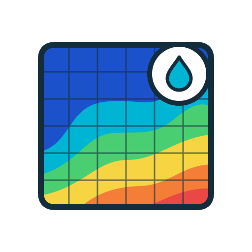
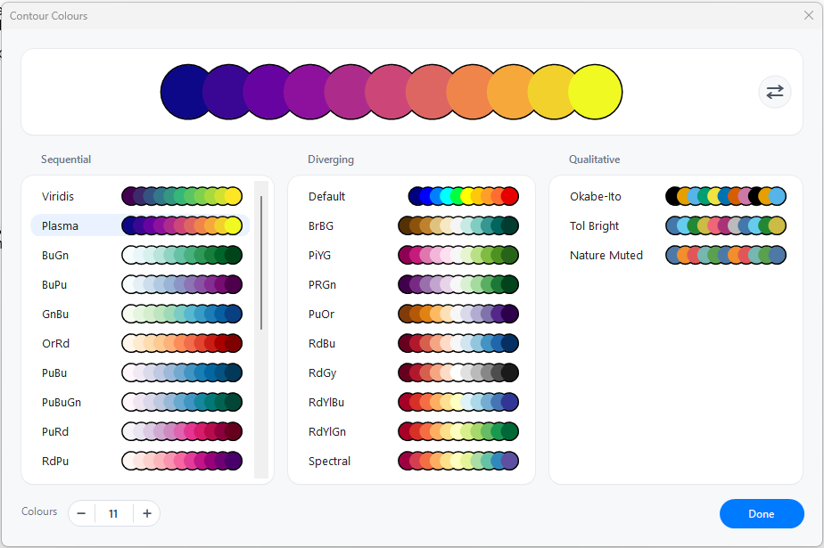
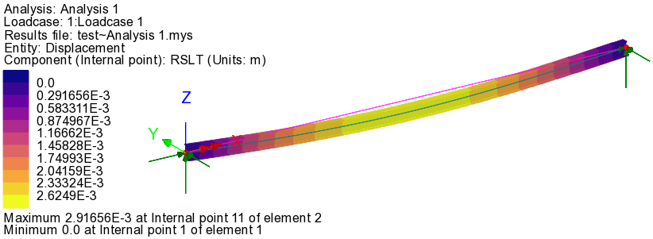

<p align="center">
  
</p>

# LUSAS Contour Colours

A LUSAS Modeller plugin for applying scientific contour colour palettes and editing individual contour colours.

## Features

- 33 built-in palettes: 20 sequential, 10 diverging and 3 qualitative.
- LUSAS `Jet` palette, using the original 10 contour seed colours, listed first under `Diverging`.
- Adjustable colour count from 2 to 20. Sequential and diverging palettes are resampled; qualitative palettes are cycled.
- Live applying: selecting a palette, changing the count or editing a colour updates the current LUSAS view immediately.
- Modeless dialog: LUSAS remains usable while the palette window is open.
- Reverse button for flipping the colour scale.
- Custom colours through the standard Windows colour picker.
- Owner-drawn interface with palette previews and overlapping colour swatches.

## Preview




## Requirements

- LUSAS 24.0, 64-bit or 32-bit.
- .NET Framework 4.7.2 developer pack.
- Visual Studio with MSBuild.

The project also contains build configurations for LUSAS 21.1, 22.0 and 23.0. The corresponding LUSAS installation must be present when building against those versions.

## Build

Close LUSAS first so the module DLL is not locked, then run:

```powershell
.\build.ps1
```

This builds `Release_240` for 64-bit LUSAS and deploys the module to:

```text
C:\ProgramData\LUSAS240\x64\Modules
```

For 32-bit LUSAS:

```powershell
.\build.ps1 -Platform Win32
```

The 32-bit output is deployed to:

```text
C:\ProgramData\LUSAS240\x86\Modules
```

To build against another installed LUSAS version:

```powershell
.\build.ps1 -Configuration Release_220
```

Available configurations are `Debug_211` through `Debug_240` and `Release_211` through `Release_240`. `build.ps1` uses `vswhere` to locate MSBuild.

The build copies the compiled assembly and `LusasContourColors.lml` manifest into the LUSAS modules directory. The assembly is strong-named.

## Use

1. Open a model in LUSAS and make sure a view is active.
2. Open `Modules > Contour Colours`.
3. Choose a palette from `Sequential`, `Diverging` or `Qualitative`.
4. Set the number of colours with the `Colours` stepper (2-20).
5. Click any colour circle to edit that colour.
6. Use the reverse icon at the top-right of the preview card to flip the scale.
7. Click `Done` or close the window with `X`.

Selecting a palette applies it immediately. A palette initially uses its native colour count: 11 for most palettes, or 10 for `Jet`. Changing the `Colours` value resamples sequential and diverging palettes; qualitative palettes are cycled. Once you change the count, that count is kept when you switch palettes. Returning to a selected palette's native count restores its original colours.

The number of contour ranges is set automatically to the number of colours minus one.

Editing an individual colour applies immediately and clears the selected palette highlight because the colours no longer match a built-in palette.

The dialog is modeless. You can continue working in LUSAS while it is open. If the window is behind LUSAS, select `Modules > Contour Colours` again to bring it to the front. Only one palette window is created.

`Reverse` clears the selected palette highlight because the reversed colours may no longer match the stored palette definition.

## Web UI

A static demo page lives in `docs/index.html`. It mirrors the plugin: all palettes, the adjustable colour count, reverse, per-colour editing through a circular colour picker, and an output box with tabs for RGB triplets, hex values and a one-line LUSAS VBScript using `BBGGRR` colour refs (e.g. `View.Contours.SetRangeAutoNumber 9,1:View.Contours.SetSeedColours Array(...),1:View.Update True`). The page is plain HTML/CSS/JS and can be served with GitHub Pages straight from the `docs` folder.

## Palette Sources

- [ColorBrewer 2.0](https://colorbrewer2.org)
- [SciDraw AI scientific colour palettes](https://sci-draw.com/blog/scientific-color-palettes-for-research-papers)

ColorBrewer palettes are stored as 11-class ramps. Shorter ramps are linearly resampled to 11 classes. Qualitative SciDraw sets are cycled to fill 11 classes. When you change the colour count, sequential and diverging palettes are linearly resampled to the chosen count, while qualitative palettes are cycled.

The complete catalog is in:

```text
src/LusasContourColors/PaletteCatalog.cs
```

Each source group is documented above its palette entries.

## How It Works

`ContourColorService` applies the selected colours to the current LUSAS view:

1. Gets the current view.
2. Creates a contours layer if one does not exist.
3. Converts each `System.Drawing.Color` to a Windows `COLORREF`.
4. Calls `view.contours().setRangeAutoNumber(colours.Count - 1, 1)` to set the contour range count.
5. Calls `view.contours().setSeedColours(values, 1)` for contour set 1.

If there is no active view, the plugin reports an error instead of applying colours.
